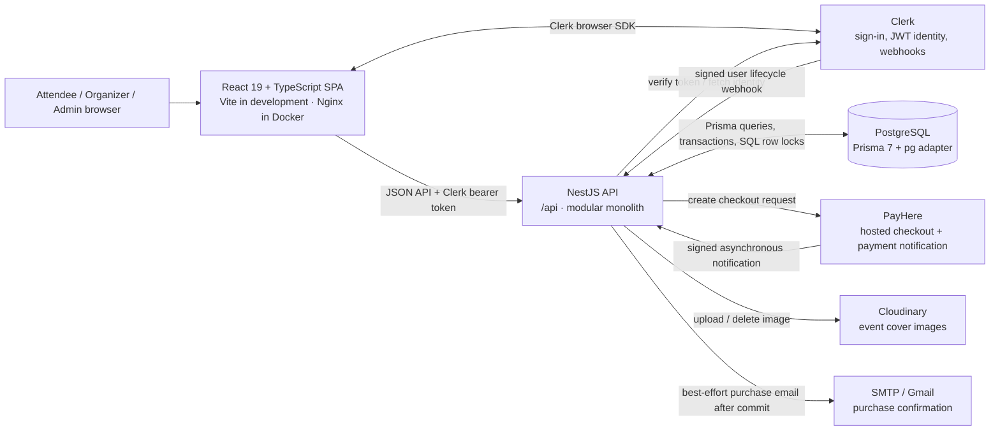
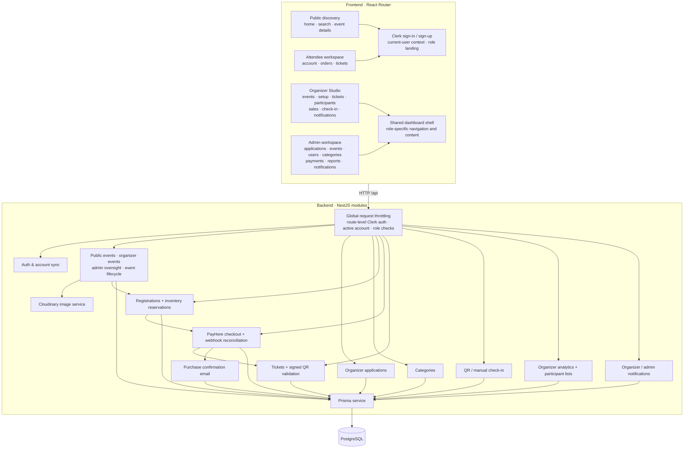
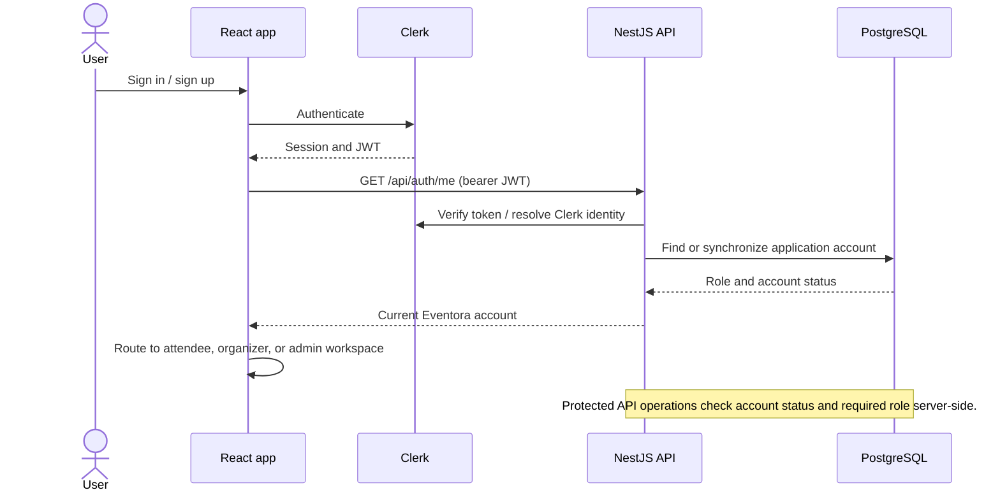
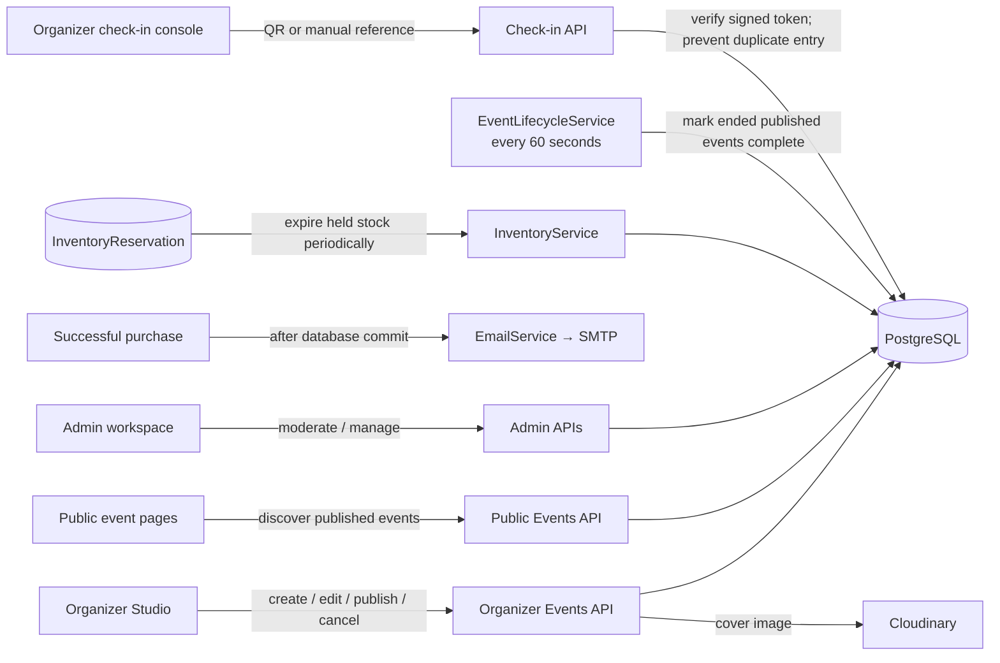
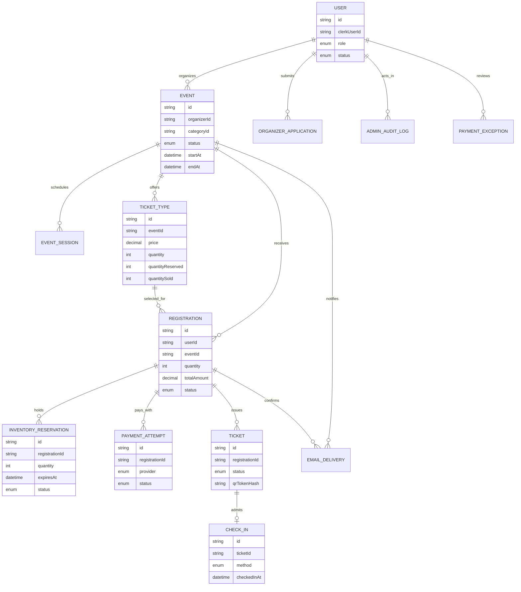

# Eventora Architecture

This document describes the architecture currently implemented in the repository. Eventora is a browser-based React application backed by a modular NestJS API and a PostgreSQL database. The API is one application; its NestJS modules are code boundaries, not separately deployed services.

## System context



In local development, Vite serves the frontend (typically port `5173`) and the API serves port `3000`. Docker Compose runs PostgreSQL, the NestJS API, and an Nginx-served frontend. Clerk, PayHere, Cloudinary, and SMTP are external integrations configured through environment variables.

## Application structure



The dashboard shell is shared presentation infrastructure. The organizer and admin screens, routes, permissions, and data remain separate. Frontend route guards improve navigation and feedback; the API independently enforces authorization.

## Authentication and authorization



Clerk owns authentication identity. Eventora stores application roles (`ATTENDEE`, `ORGANIZER`, `ADMIN`) and account status in PostgreSQL. Organizer approval and role changes are application-side decisions; the browser cannot grant itself a role.

## Ticket purchase and fulfillment

```mermaid
sequenceDiagram
    actor Attendee
    participant UI as React app
    participant API as NestJS API
    participant DB as PostgreSQL
    participant PayHere
    participant Mail as SMTP

    Attendee->>UI: Select paid ticket tier and quantity
    UI->>API: POST /api/registrations
    API->>DB: Transaction: reserve inventory atomically; create registration and timed hold
    DB-->>API: Pending registration
    API-->>UI: Registration and hold expiry
    UI->>API: Start checkout for registration
    API->>DB: Verify ownership and active hold
    API-->>UI: PayHere hosted-checkout details
    UI->>PayHere: Redirect to hosted payment page
    PayHere-->>Attendee: Collect payment
    PayHere->>API: Signed payment notification
    API->>API: Verify provider signature and reconcile idempotently
    API->>DB: Transaction: update payment, commit/release inventory, confirm registration, issue tickets
    DB-->>API: Committed result
    API->>Mail: Best-effort confirmation email after commit
    API-->>PayHere: Acknowledge notification
    UI->>API: GET /api/tickets/me or /api/registrations/me
    API-->>UI: Tickets / order history
```

The payment provider notification is the source of truth for payment completion. A browser return page alone does not issue a ticket. Reservation expiry, payment reconciliation, and ticket issuance are persisted against PostgreSQL transactions; late or mismatched payments can be recorded for administrative review.

## Event operations and background work



Purchase email is attempted after the payment transaction commits; SMTP failure does not roll back the payment and is not retried. Reservation-expiry and event-lifecycle jobs currently run as timers inside the NestJS application process.

## Main persisted concepts



This is a domain overview, not a complete ERD. The authoritative field definitions and relationship constraints are in [`backend/prisma/schema.prisma`](backend/prisma/schema.prisma).

## Where to look in the repository

| Concern | Code location |
|---|---|
| Frontend bootstrap and route map | `frontend/src/main.tsx`, `frontend/src/app/routes.tsx` |
| Authenticated API requests and role context | `frontend/src/features/auth/` |
| Role dashboards | `frontend/src/features/organizer/`, `frontend/src/features/admin/`, `frontend/src/features/tickets/` |
| NestJS module composition | `backend/src/app.module.ts` |
| API startup, validation, CORS, `/api` prefix | `backend/src/main.ts` |
| Authentication and role guards | `backend/src/auth/` |
| Event, registration, payment, ticket, check-in domains | `backend/src/events/`, `backend/src/registrations/`, `backend/src/payments/`, `backend/src/tickets/`, `backend/src/checkins/` |
| Database model and migrations | `backend/prisma/schema.prisma`, `backend/prisma/migrations/` |
| Compose topology | `docker-compose.yml` |
